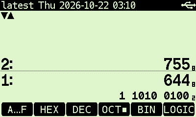

# DM42PGM for DM42/DM42n

A custom Free42 frontend for SwissMicros DM42/DM42n calculators, paired with the [extended Free42 core](https://github.com/aiotter/dm42-free42).
The core repository also provides a desktop GTK application.

## Extensions

- Added device rendering for the core's alternate-radix display in `BASE` mode, showing the same value in another radix alongside the main display.
- Moved the original home-menu entries to `SETUP` and added custom home buttons for the core's history and program-editing features.

  - `AGAIN`: repeat the last command, reinsert the last program instruction, or repeat a search.
  - `UNDO` / `REDO`: undo or redo calculations, program edits, and cursor movements.
  - `TIME`: open time display and entry mode from the normal home menu, or execute `T.CALC`. Select precision with `H.M`, `H.MS`, or `H.MSs`, and display rounding with `RND` or `TRNC`.
    During number entry, `1d` multiplies the entered duration by 24 and confirms it; otherwise it enters 24 hours.
  - `LBLs`: select a label and move the cursor to it.
  - `JUMP`: follow the `GTO` or `XEQ` at the cursor without executing it.
  - `FIND↓`: move to the next matching command or text in the current program.

- Added USB-dependent home buttons in normal mode: connecting USB makes `Disk` appear for USB disk access and `Boot` for bootloader entry.

## Build and flash

Use [DM42PGM.nix](https://github.com/aiotter/DM42PGM.nix) to build firmware with the custom frontend and core.
Follow its [USB flashing instructions](https://github.com/aiotter/DM42PGM.nix#direct-usb-flashing) to install on a DM42n.

## Development

The Makefile automatically compiles `dm/*_custom.cc`, with module interfaces declared in `.h` files.

- [Frontend tests](tests/README.md)
