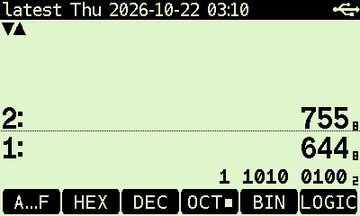

# DM42PGM for DM42/DM42n

A custom Free42 frontend for SwissMicros DM42/DM42n calculators, paired with the [extended Free42 core](https://github.com/aiotter/dm42-free42).
The core repository also provides a desktop GTK application.

## Device controls

### HOME menu

Free42 defines the [HOME key assignments](https://github.com/aiotter/dm42-free42#home-menu) for normal and program modes.
The original HOME settings are under `SETUP` → `Display & Sound`. `Help` is directly under `SETUP`.

When the calculator detects USB power in normal mode, the HOME menu offers these shortcuts.

- `Disk` (F4) activates USB disk access.
- `Boot` (Shift+F4) enters bootloader mode.

### Display

- In `BASE` mode, the stack display can show the X register in a second radix.

## Build and flash

Use [DM42PGM.nix](https://github.com/aiotter/DM42PGM.nix) to build firmware with the custom frontend and core.
Follow its [USB flashing instructions](https://github.com/aiotter/DM42PGM.nix#direct-usb-flashing) to install the firmware on a DM42 or DM42n.

## Development

The Makefile automatically compiles `dm/*_custom.cc`, with module interfaces declared in `.h` files.

- [Frontend tests](tests/README.md)
